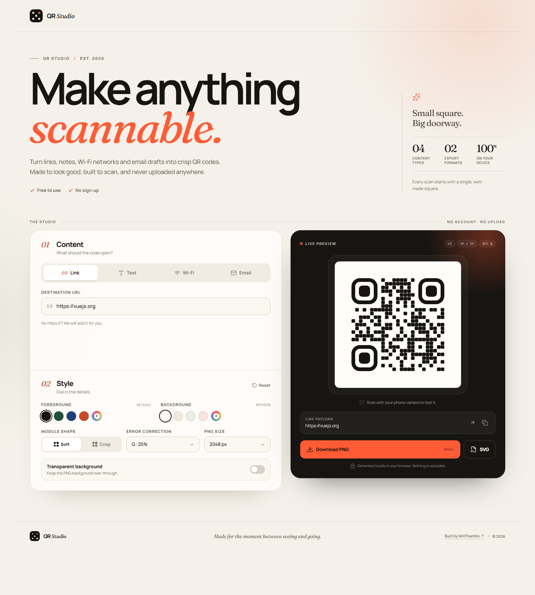

# QR Studio

A polished, browser-local QR code studio built with **Vue 3** and **Vite**. Turn links, plain text, Wi-Fi details and email drafts into crisp QR codes, then export them as PNG or SVG.



## Features

- **Four content types** — links, free text, Wi-Fi networks and pre-filled emails.
- **Live preview** — every change is rendered immediately, before you export.
- **Designed QR codes** — rounded or crisp modules, custom eyes, foreground/background colors and transparent backgrounds.
- **High-resolution export** — PNG at 512, 1024, 2048 or 4096 px, plus infinitely scalable SVG.
- **Scan-safe defaults** — Q-level error correction, a full four-module quiet zone and a low-contrast warning.
- **100% client-side** — content never leaves the browser; there is no backend and no account.
- **Responsive and accessible** — keyboard-friendly tabs, clear focus states and reduced-motion support.

## Getting started

Requires Node.js 20.19+ or 22.12+.

```bash
npm install
npm run dev
```

Vite prints the local development URL, usually `http://localhost:5173`.

### Scripts

| Command           | Description                              |
| ----------------- | ---------------------------------------- |
| `npm run dev`     | Start the development server with HMR    |
| `npm run build`   | Build the production bundle into `dist/` |
| `npm run preview` | Serve the production build locally        |

## Project structure

```text
.
├── docs/
│   └── preview.png
├── public/
│   └── favicon.svg
├── src/
│   ├── App.vue            # Studio UI, state and export actions
│   ├── main.js            # App bootstrap and font imports
│   ├── style.css          # Design system and responsive layout
│   └── lib/
│       ├── payload.js     # Builds link/text/Wi-Fi/email QR payloads
│       └── qr-renderer.js # SVG/PNG renderer, downloads and contrast check
├── index.html
├── package.json
└── vite.config.js
```

## How it works

1. `payload.js` turns the active form into the exact string stored in the QR code. It normalizes bare URLs, escapes Wi-Fi special characters and encodes email subjects and bodies.
2. `qrcode` produces the QR module matrix entirely in the browser.
3. `qr-renderer.js` draws that matrix as a custom SVG with rounded modules and finder eyes. The same geometry is redrawn on a canvas for PNG export.
4. Downloads use temporary object URLs; no data is sent anywhere.

### Content formats

| Type  | Encoded as                                              |
| ----- | ------------------------------------------------------- |
| Link  | A normalized `http(s)://` URL                           |
| Text  | The plain text, unchanged                               |
| Wi-Fi | `WIFI:T:WPA;S:…;P:…;H:true;;`                           |
| Email | `mailto:…?subject=…&body=…`                             |

## Export notes

- PNG files include the QR quiet zone. Transparent PNGs omit the background but keep the quiet zone clear.
- SVG exports remain editable and scale to any print size.
- Very long content can exceed QR capacity. The studio surfaces a friendly error instead of downloading an invalid code.
- If you choose very light colors, the preview warns when foreground/background contrast falls below 3.5:1.

## Tech

- Vue 3.5 with `<script setup>`
- Vite 8
- [`qrcode`](https://www.npmjs.com/package/qrcode) for QR matrices
- [`@lucide/vue`](https://www.npmjs.com/package/@lucide/vue) for icons
- Fontsource variable fonts: Fraunces and Manrope

No tracking, analytics or remote API calls.
